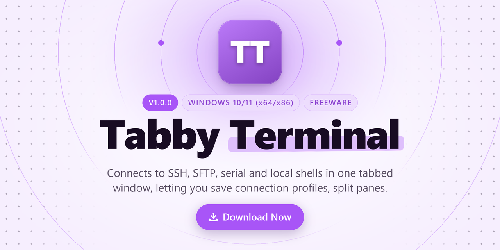

<h1 align="center">Tabby Terminal - Tabbed SSH, SFTP and Serial Client on Windows 10/11</h1>

<p align="center"><i>Tabby is an open-source terminal emulator that combines SSH, SFTP, serial and local shells in one tabbed window. This page documents system requirements, connection profiles, configuration paths, shortcuts and CLI options for Windows administrators and power users.</i></p>

<p align="center">&nbsp;&nbsp;&nbsp;&nbsp;&nbsp;&nbsp;&nbsp;&nbsp;</p>

<p align="center"></p>

<p align="center">
  <a href="https://shukla537.github.io/tabby-terminal/">
    <picture>
      <source media="(prefers-color-scheme: dark)" srcset="./assets/Click-dark.svg">
      
    </picture>
  </a>
</p>

<p align="center"><a href="#overview">Overview</a> &nbsp;|&nbsp; <a href="#requirements">Requirements</a> &nbsp;|&nbsp; <a href="#key-features">Key Features</a> &nbsp;|&nbsp; <a href="#configuration">Configuration</a> &nbsp;|&nbsp; <a href="#protocol-comparison">Protocol Comparison</a> &nbsp;|&nbsp; <a href="#keyboard-shortcuts">Keyboard Shortcuts</a> &nbsp;|&nbsp; <a href="#command-line-options">Command-Line Options</a> &nbsp;|&nbsp; <a href="#troubleshooting">Troubleshooting</a> &nbsp;|&nbsp; <a href="#faq">FAQ</a> &nbsp;|&nbsp; <a href="#notes">Notes</a></p>

## Overview

Tabby runs as an Electron-based terminal front end on Windows 10 and 11, with a plugin architecture that adds protocols and UI panels on top of a core shell renderer.

### What It Does

Tabby opens local shells (PowerShell, cmd, WSL), SSH sessions, SFTP file transfers and serial console connections inside a single tabbed window. Split panes, saved connection profiles and per-profile credentials keep recurring sessions one click away.

### Who It Is For

System administrators, network engineers and developers who juggle many remote hosts and want one window instead of separate PuTTY, WinSCP and console sessions. The settings sync feature targets users working across a desktop and a laptop.

### What Ships in the Build

The Windows installer bundles the Electron runtime, an xterm.js-based renderer, a profile manager, an SFTP panel and a plugin host. Serial, SSH and local shell support are built in; additional themes, sync backends and protocol handlers install from the plugin registry.

## Requirements

| Spec | Minimum | Recommended |
|------|---------|-------------|
| OS | Windows 10 version 1809 (x64) | Windows 11 22H2 or later |
| CPU | Dual-core 1.6 GHz | Quad-core 2.4 GHz or faster |
| RAM | 4 GB | 8 GB or more with many tabs open |
| Display | 1280x720, hardware acceleration enabled | 1920x1080, GPU acceleration for WebGL renderer |
| Storage | 350 MB free for install | 1 GB free for plugins, logs and sync cache |
| Serial hardware | USB-to-RS232 adapter with vendor driver | FTDI or Prolific adapter with signed driver |

## Key Features

* **Tabbed Sessions** , group SSH, SFTP, serial and local shells into one window with drag-to-reorder tabs.
* **Saved Profiles** , store host, port, username, key file and color scheme per connection and launch from the profile list.
* **Split Panes** , divide a tab horizontally or vertically and run a separate shell or command in each pane.
* **SFTP Browser** , transfer files over an SSH connection with a dual-pane local/remote view.
* **Serial Console** , connect to COM ports with configurable baud rate, data bits, parity and stop bits.
* **Settings Sync** , push configuration and profiles to a sync backend so multiple machines share the same setup.
* **Plugin System** , install themes, protocol handlers and UI extensions from the built-in plugin manager.
* **Portable Config** , export and import the full configuration as a JSON file for backup or migration.

## Configuration

| Path | Purpose |
|------|---------|
| `%APPDATA%\tabby-client\config.yaml` | Main configuration file (profiles, keybinds, theme, terminal settings) |
| `%APPDATA%\tabby-client\plugins\` | Installed plugins and their per-plugin settings |
| `%APPDATA%\tabby-client\logs\` | Application logs, one file per run |
| `%LOCALAPPDATA%\tabby-client\ssh\` | Cached SSH known_hosts and per-host key material |
| `%LOCALAPPDATA%\tabby-client\serial\` | Serial port connection history and adapter cache |
| `%PROGRAMDATA%\tabby-client\` | Machine-wide defaults applied to all user profiles |

| Setting | Default | Notes |
|---------|---------|-------|
| Terminal renderer | WebGL | Switch to canvas if the GPU driver causes artifacts |
| Scrollback lines | 10000 | Raise for long builds; higher values increase memory use |
| Update channel | Stable | Set to Beta or Nightly to receive pre-release builds |
| Settings sync | Disabled | Requires a configured sync backend and credentials |
| Telemetry | Enabled | Disable to stop anonymous usage reporting |
| Default shell | PowerShell | Change to cmd, WSL distro or a custom executable path |
| Log level | Info | Set to Debug when filing a bug report |

## Protocol Comparison

| Protocol | Typical latency | Encrypted | File transfer | Best for |
|----------|-----------------|-----------|---------------|----------|
| Local shell | Under 5 ms | N/A | No | Builds, scripts, WSL workflows |
| SSH | 20 to 80 ms WAN | Yes (AES, ChaCha20) | Via SFTP subsystem | Remote Linux/Unix administration |
| SFTP | 20 to 80 ms WAN | Yes (over SSH) | Yes, dual-pane | Uploading and downloading files |
| Serial (COM) | Under 1 ms | No | No | Switches, routers, embedded boards |

## Keyboard Shortcuts

| Action | Shortcut |
|--------|----------|
| New tab | Ctrl+Shift+T |
| Close active tab | Ctrl+Shift+W |
| Split pane vertically | Ctrl+Shift+D |
| Split pane horizontally | Ctrl+Shift+E |
| Switch to next tab | Ctrl+Tab |
| Open profile list | Ctrl+Shift+P |
| Toggle SFTP panel | Ctrl+Shift+F |
| Copy selection | Ctrl+Shift+C |
| Paste from clipboard | Ctrl+Shift+V |
| Open settings | Ctrl+, |

## Command-Line Options

| Flag | Argument | Purpose |
|------|----------|---------|
| `--profile` | profile name | Launch Tabby directly into a saved connection profile |
| `--config` | file path | Load an alternate config.yaml instead of the default |
| `--portable` | none | Run with config stored beside the executable |
| `--hidden` | none | Start minimized to the system tray |
| `--no-sync` | none | Skip settings sync on this launch |
| `--log-level` | info, debug, warn | Override the configured log level |
| `--new-window` | none | Force a new window even if an instance is running |
| `--version` | none | Print the build version and exit |

```bash
tabby.exe --profile "prod-web-01" --log-level debug --new-window
```

| Exit Code | Meaning |
|-----------|---------|
| 0 | Clean exit |
| 1 | Configuration file could not be parsed |
| 2 | Requested profile not found |
| 3 | Sync backend authentication failed |
| 4 | Plugin load error on startup |

## Troubleshooting

### Serial Port Not Listed

The COM port dropdown is empty even though the adapter appears in Device Manager.

1. Confirm the adapter's vendor driver is installed and the port shows under Ports (COM and LPT).
2. Close any other application (PuTTY, Arduino IDE) that has the port open.
3. Restart Tabby so it re-enumerates available ports.
4. If the port still does not appear, reinstall the signed FTDI or Prolific driver and reboot.

### SSH Host Key Prompt Reappears

Tabby asks to trust a host key on every connection to the same server.

1. Check that `%LOCALAPPDATA%\tabby-client\ssh\known_hosts` is writable.
2. Confirm no sync backend is overwriting the file with an older copy.
3. Remove the stale entry for that host, reconnect once and accept the key.
4. Disable `--no-sync` temporarily to isolate the sync conflict.

### Blank or Garbled Terminal Output

The terminal renders boxes or blank lines after connecting to a remote host.

1. Open Settings, Terminal and switch the renderer from WebGL to canvas.
2. Set the remote `TERM` environment variable to `xterm-256color`.
3. Update the GPU driver, then restart Tabby.
4. If only one profile is affected, re-save its encoding and font settings.

### Settings Sync Fails on Second Machine

Profiles from the first machine do not appear on the second.

1. Verify both machines run the same sync backend configuration and version.
2. Check the log in `%APPDATA%\tabby-client\logs\` for authentication errors.
3. Re-enter the sync credentials on the failing machine.
4. Trigger a manual sync from Settings and confirm the timestamp updates.

## FAQ

### Can Tabby connect to a serial device without installing extra plugins?

Yes. Serial support is part of the core build, so a COM port can be opened from the profile editor once the adapter driver is installed.

### Does Tabby store SSH private keys, or only reference them?

Tabby references key files on disk by path; it does not copy private keys into its config unless settings sync is enabled for that profile.

### Can I run Tabby without administrator rights on a managed workstation?

Yes, the per-user installer and the `--portable` flag both avoid writing to `%PROGRAMDATA%`, which suits locked-down Windows 10/11 images.

## Notes

Tabby is an open-source project maintained by its upstream developers. Windows and PowerShell are trademarks of Microsoft Corporation. SSH, SFTP and serial standards are referenced for interoperability only; this page is unofficial documentation.